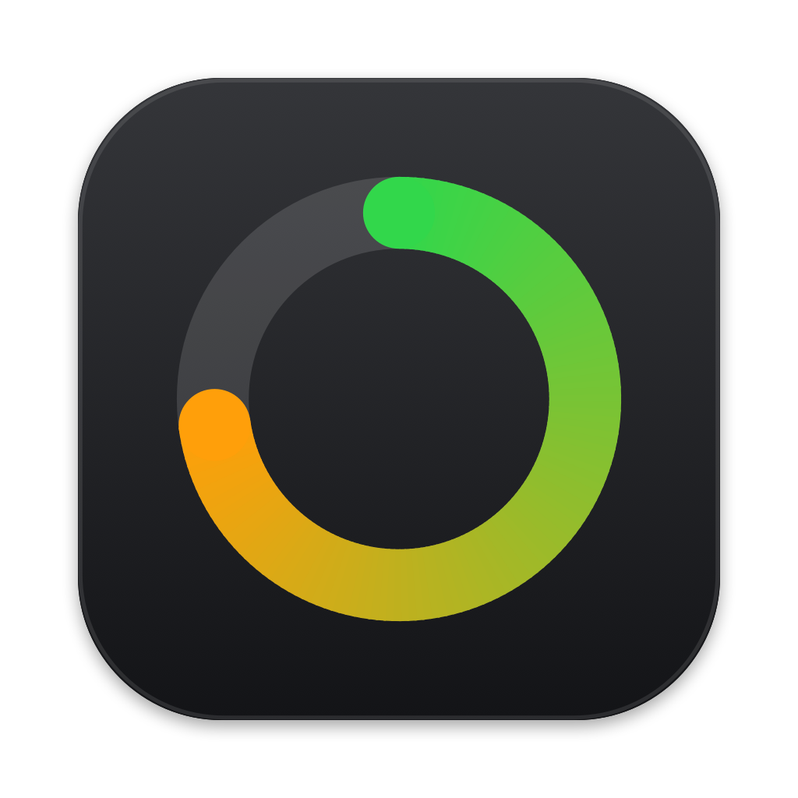
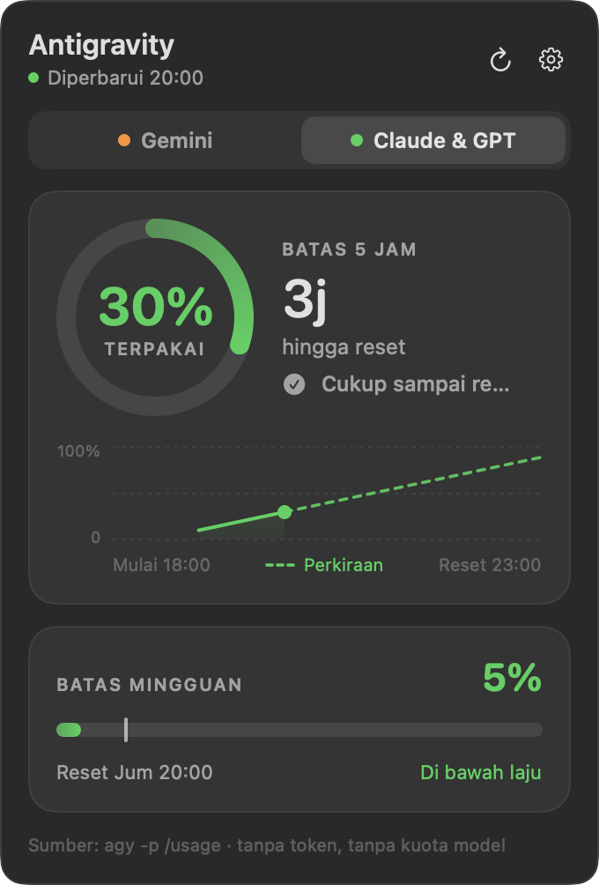
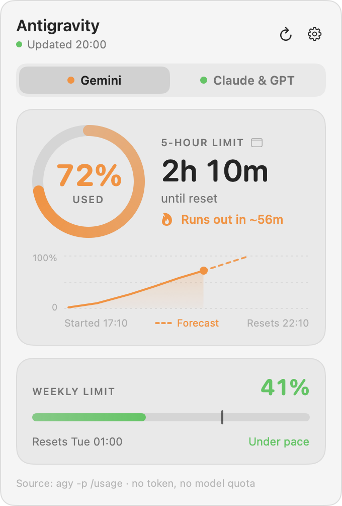
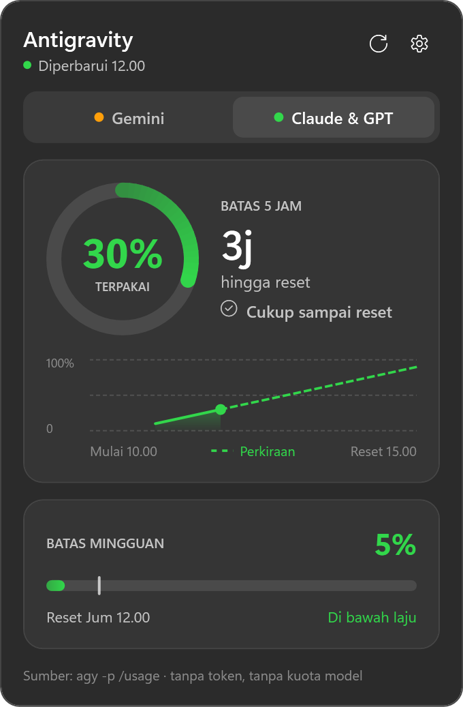
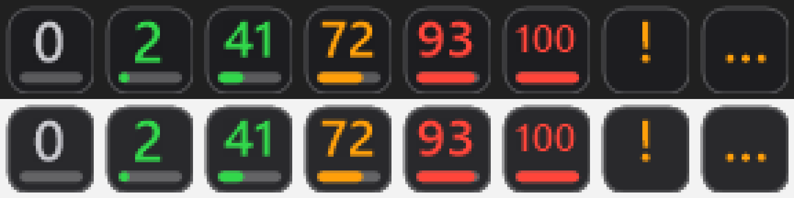

<p align="center">
  
</p>

<h1 align="center">Agy Usage Bar</h1>

<p align="center">
  Batas pemakaian <b>Antigravity CLI (<code>agy</code>)</b> di menu bar macOS dan system tray Windows:<br>
  pemakaian 5 jam dan mingguan, hitung mundur reset, dan perkiraan apakah kuota habis sebelum reset.
</p>

<p align="center"><a href="README.md">English</a></p>

<p align="center">
  
  &nbsp;
  
</p>

<p align="center">
  
  &nbsp;
  
</p>

<p align="center"><sub>Aplikasi menu bar macOS (atas) dan aplikasi tray Windows (bawah). Ikon tray Windows menampilkan persen terpakai; warna dan barnya mengikuti pita hijau / oranye / merah yang sama.</sub></p>

## Isinya

- **Pengukur langsung di tempat yang selalu terlihat.** macOS: cincin berwarna dan teks `72% · 2j 10m` di menu bar. Windows: ikon tray berisi persen terpakai dengan bar pengisi.
- **Semua yang dilaporkan agy**: batas 5 jam dan mingguan untuk kedua kelompok model (Gemini, serta Claude & GPT), lengkap dengan hitung mundur reset.
- **Perkiraan laju.** "Habis ±56m lagi" bila laju sekarang menghabiskan jendela 5 jam sebelum reset, "Cukup sampai reset" bila tidak, dan penanda "laju merata" di bar mingguan supaya terlihat Anda di depan atau di belakang.
- **Grafik tren** jendela 5 jam berjalan dengan garis perkiraan putus-putus.
- **Terang dan gelap**, bahasa Inggris dan Indonesia (mengikuti sistem, bisa diganti), buka otomatis saat login, tanpa dependensi.

### Tidak menyentuh kredensial Anda

Aplikasi hanya menjalankan satu perintah, `agy -p "/usage" --output-format json`, tiap tiga menit. Itu CLI resmi yang membaca kuota Anda. Perintah ini **tidak memanggil model (0 token)**, jadi tidak memakai kuota; **tidak membaca** token login, keychain, atau penyimpanan kredensial; dan **tidak membuka koneksi jaringan** sendiri.

Alat yang memanggil endpoint kuota Google memakai token yang disimpan `agy` adalah hal yang berbeda; aplikasi ini sengaja menghindarinya.

## Pasang

Anda butuh [`agy`](https://antigravity.google/) yang sudah terpasang dan login (`agy --version` harus jalan). Diuji dengan agy 1.4.7.

Unduh pemasang untuk komputer Anda dari **[rilis terbaru](https://github.com/AxelanO7/agy-usage-bar/releases/latest)**:

| Komputer Anda | Berkas | Caranya |
|---|---|---|
| Mac (macOS 13+, Apple Silicon atau Intel) | `AgyUsageBar-macos.dmg` | buka, seret aplikasinya ke *Applications* |
| Windows 10/11 (Intel/AMD) | `AgyUsageBar-win-x64.msi` | klik dua kali |
| Windows 10/11 ARM | `AgyUsageBar-win-arm64.msi` | klik dua kali |
| Windows tanpa pemasang | `AgyUsageBar-win-x64.exe` / `-arm64.exe` | satu berkas, langsung jalankan (tanpa .NET) |

Aplikasinya belum ditandatangani dengan sertifikat pengembang berbayar, jadi macOS dan Windows menampilkan peringatan satu kali saat pertama dibuka. Itu wajar; lihat di bawah.

### macOS 13 atau lebih baru

1. Buka `AgyUsageBar-macos.dmg`, seret **AgyUsageBar** ke **Applications**, lalu jalankan dari Launchpad.
2. Pertama dibuka, macOS bilang tidak bisa memeriksa aplikasi dari malware. Buka **System Settings → Privacy & Security**, gulir ke pesan tentang AgyUsageBar, lalu klik **Open Anyway**. (Di macOS 13 dan 14, klik kanan → **Open** juga bisa.) Lewat terminal: `xattr -dr com.apple.quarantine /Applications/AgyUsageBar.app`.
3. Klik cincin di menu bar. Lewat ikon gerigi Anda bisa memilih apa yang tampil di menu bar dan menyalakan **Buka saat login**.

### Windows 10 atau 11

1. Klik dua kali berkas `.msi`. Terpasang hanya untuk akun Anda (tanpa hak administrator) di `%LOCALAPPDATA%\Programs\AgyUsageBar`, menambah menu Start, dan langsung menjalankan aplikasinya.
2. Windows bisa menampilkan "Windows protected your PC" karena pemasang belum ditandatangani: **More info → Run anyway**.
3. Windows 11 menyembunyikan ikon tray baru: buka panah **^**, lalu seret ikonnya ke taskbar supaya selalu terlihat. Klik kiri membuka panel, klik kanan membuka menu (isi ikon, bahasa, buka saat login, keluar).
4. Hapus lewat **Settings → Apps → Agy Usage Bar**. Versi baru terpasang di atas versi lama.

Pasang senyap untuk banyak komputer atau skrip: `msiexec /i AgyUsageBar-win-x64.msi /qn` (tambahkan `LAUNCHATLOGIN=1` agar jalan di setiap login).

> **Status Windows: beta.** Aplikasi Windows sudah diuji unit, tampilannya dirender di runner CI Windows, dan CI memasang, memperbarui, serta menghapus MSI di setiap perubahan, tetapi pemakaian nyatanya lebih sedikit daripada versi macOS. Silakan [buka issue](https://github.com/AxelanO7/agy-usage-bar/issues) bila ada yang janggal.

### Lewat terminal

Skrip mengunduh rilis terbaru lalu memasangnya (baca dulu: [`install.sh`](scripts/install.sh), [`install.ps1`](scripts/install.ps1)). Berkas yang diunduh dengan `curl` tidak diberi karantina, jadi macOS tidak menampilkan peringatan.

```sh
# macOS
curl -fsSL https://raw.githubusercontent.com/AxelanO7/agy-usage-bar/main/scripts/install.sh | bash
```

```powershell
# Windows (PowerShell)
irm https://raw.githubusercontent.com/AxelanO7/agy-usage-bar/main/scripts/install.ps1 | iex
```

### Bangun sendiri

macOS (Xcode Command Line Tools, Swift 5.9+):

```sh
cd macos
./make_dmg.sh                       # AgyUsageBar.app universal (Apple Silicon + Intel), .dmg dan .zip di ../dist
cp -R AgyUsageBar.app ~/Applications/
```

Windows (.NET 10 SDK; MSI-nya butuh komputer Windows):

```powershell
dotnet publish windows/src/AgyUsageBar -c Release -r win-x64 --self-contained true -p:PublishSingleFile=true -p:EnableCompressionInSingleFile=true --output publish
./windows/installer/build-msi.ps1 -Exe publish/AgyUsageBar.exe -Arch x64 -Version 0.1.0 -Out AgyUsageBar-win-x64.msi
```

## Biar AI coding agent yang memasang

Tempel ini ke OpenCode, Claude Code, Codex, Cursor, atau agen apa pun yang bisa menjalankan perintah shell. Agen akan membaca [INSTALL.md](INSTALL.md) dan mengerjakan sisanya.

```text
Pasangkan "Agy Usage Bar" di komputer ini: aplikasi yang menampilkan limit Antigravity CLI (agy) saya di menu bar macOS / system tray Windows.
Repo: https://github.com/AxelanO7/agy-usage-bar

1. Ambil https://raw.githubusercontent.com/AxelanO7/agy-usage-bar/main/INSTALL.md lalu ikuti persis.
2. Cek dulu `agy --version` jalan dan `agy -p "/usage" --output-format json` mengembalikan "status":"SUCCESS". Kalau agy belum ada atau belum login, berhenti dan kabari saya; jangan memasang agy sendiri.
3. Pakai skrip pemasang untuk OS saya (baca dulu sebelum dijalankan). Jangan pakai sudo/admin, jangan baca atau cetak token/kredensial apa pun, dan jangan mengubah apa pun di luar pemasangan.
4. Pastikan aplikasinya jalan dan ikonnya muncul di menu bar / tray, lalu ceritakan apa yang dipasang dan di mana.
```

## Cara pakai

| | macOS | Windows |
|---|---|---|
| Pengukur sekilas | cincin + `72% · 2j 10m` di menu bar | ikon tray: persen di ubin gelap dengan bar pengisi (arahkan kursor untuk teks lengkap) |
| Buka panel | klik kiri | klik kiri |
| Pengaturan | ikon gerigi di panel | ikon gerigi di panel, atau klik kanan ikon |
| Pilih isi ikon | Gemini atau Claude & GPT, 5 jam atau mingguan, atau yang tertinggi | sama |
| Perbarui sekarang | tombol refresh | tombol refresh / menu |

Warna mengikuti seberapa banyak yang terpakai: hijau sampai 60%, oranye 61-85%, merah di atas 85%.

Batas yang belum pernah dipakai tampil "Belum dipakai": agy baru memulai jendela saat permintaan pertama Anda, dan sebelum itu waktu reset-nya hanya "sekarang + panjang jendela", jadi aplikasi tidak menampilkan hitung mundur palsu.

## Cara kerja

```text
agy -p "/usage" --output-format json
```

mengembalikan kuota dalam JSON (diringkas):

```json
{"status":"SUCCESS","command":{"name":"usage","data":{"groups":[
  {"name":"Gemini Models","buckets":[
    {"id":"gemini-5h","window":"5h","remaining_fraction":0.986,"reset_time":"2026-10-24T14:59:51Z"},
    {"id":"gemini-weekly","window":"weekly","remaining_fraction":0.988,"reset_time":"2026-10-30T23:07:13Z"}]},
  {"name":"Claude and GPT models","buckets":[ ... "3p-5h", "3p-weekly" ... ]}]}}}
```

Aplikasi memeriksa tiap 3 menit (mundur sampai 15 menit setelah gagal berulang), memperbarui saat panel dibuka bila data lebih tua dari 30 detik, dan memperbarui setelah komputer bangun dari tidur. Satu pemeriksaan butuh sekitar 3 detik dan seperempat detik CPU.

**Perkiraan laju** dan **grafik tren** berasal dari riwayat lokal kecil berisi persen yang pernah dilihat aplikasi (7 hari, beberapa KB). Laju dihitung dari 90 menit terakhir untuk jendela 5 jam dan 24 jam terakhir untuk mingguan. agy kadang menurunkan persen terpakai sedikit di dalam satu jendela (pemakaian lama meluruh), jadi hanya penurunan lebih dari 2 poin yang dianggap reset.

Berkas yang ditulis aplikasi: macOS `~/Library/Application Support/AgyUsageBar/`, Windows `%LOCALAPPDATA%\AgyUsageBar\` (hasil terakhir, riwayat, pengaturan). Hapus folder itu untuk mengatur ulang.

Cara `agy` ditemukan: variabel lingkungan `AGY_PATH`, lalu `PATH` dan folder pemasangan umum; macOS juga bertanya ke login shell. Di Windows Anda juga bisa memilih `agy.exe` lewat menu tray. Setel `AGY_USAGE_LANG=en` atau `id` untuk memaksa bahasa.

## Pemecahan masalah

| Yang terlihat | Yang dilakukan |
|---|---|
| `agy?` / "Perintah agy tidak ditemukan" | Pasang agy, atau setel `AGY_PATH` ke lokasi lengkapnya (Windows: menu tray → *Pilih lokasi agy.exe…*). |
| `Login` / "agy belum login" | Jalankan `agy` sekali di terminal lalu masuk. |
| "Keluaran agy tidak dikenali" | Format `/usage` agy berubah. Antarmuka ini tidak terdokumentasi sebagai stabil, mohon buka issue beserta `agy --version`. |
| Tidak ada ikon di Windows 11 | Ikonnya ada di panah **^**: seret ke taskbar. |
| macOS: "tidak dapat dibuka" / "Apple tidak dapat memverifikasi…" | System Settings → Privacy & Security → **Open Anyway**, atau perintah `xattr` di atas. |
| Item menu bar hilang di MacBook berponi | Menu bar penuh: tutup item lain, atau pilih tampilan lebih pendek di menu gerigi (matikan *Tampilkan hitung mundur*). |

## Pengembangan

```text
macos/     aplikasi SwiftUI + AppKit (Swift Package, tanpa dependensi)
windows/   solusi .NET 10: pustaka Core (logika bersama), aplikasi tray WPF + WinForms, uji xUnit
tools/     pembuat ikon
```

```sh
# macOS
cd macos && swift build && .build/debug/AgyUsageBar --selftest

# Windows (uji Core bisa dijalankan di OS apa pun)
dotnet test windows/tests/AgyUsageBar.Tests
```

Kedua aplikasi bisa merender tampilannya tanpa layar, begitulah tangkapan layar di sini dan pemeriksaan CI dibuat:

```sh
AgyUsageBar --snapshot out.png --demo --dark --lang id     # macOS
AgyUsageBar.exe --snapshot out.png --dark --lang id        # Windows (data demo)
```

Aplikasi macOS dan Windows adalah dua implementasi native dari desain yang sama. Keduanya tidak berbagi kode, tetapi rangkaian ujinya memakai fixture dan nilai harapan yang sama.

## Penafian

Proyek ini independen dan tidak berafiliasi atau didukung oleh Google. "Antigravity" adalah merek dagang Google LLC. Aplikasi hanya menjalankan perintah `agy` yang sudah Anda miliki; format keluarannya ditentukan Google dan bisa berubah.

## Lisensi

[MIT](LICENSE)
