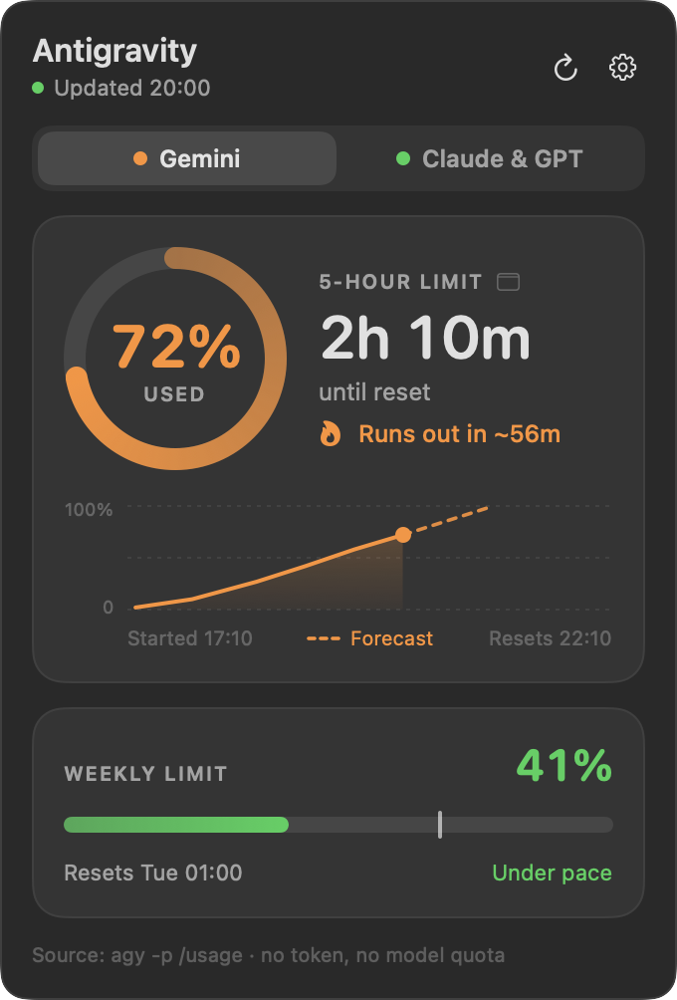

<p align="center">
  
</p>

<h1 align="center">Agy Usage Bar</h1>

<p align="center">
  Your <b>Antigravity CLI (<code>agy</code>)</b> limits in the macOS menu bar and the Windows system tray:<br>
  5-hour and weekly usage, time until reset, and a forecast of whether you will run out first.
</p>

<p align="center">
  <a href="https://github.com/AxelanO7/agy-usage-bar/actions/workflows/ci.yml"></a>
  
  
  
</p>

<p align="center"><a href="README.id.md">Bahasa Indonesia</a></p>

<p align="center">
  
  &nbsp;
  
</p>

## What you get

- **A live gauge where you can always see it.** macOS: a colored ring plus `72% · 2h 10m` in the menu bar. Windows: a tray icon with the used percentage and a fill bar.
- **Everything agy reports**: the 5-hour and the weekly limit for both model pools (Gemini, and Claude & GPT), with the reset countdown.
- **A pace forecast.** "Runs out in ~56m" when your current burn rate will exhaust the 5-hour window before it resets, "Lasts until reset" when it won't, and an "even pace" tick on the weekly bar so you can see whether you are ahead or behind.
- **A trend chart** of the current 5-hour window with a dashed forecast line.
- **Light and dark**, English and Indonesian (follows your system, switchable), launch at login, zero dependencies.

### It does not touch your credentials

The app runs one command, `agy -p "/usage" --output-format json`, every three minutes. That is the official CLI reading your quota. It makes **no model call (0 tokens)**, so it never spends quota; it does **not** read your login token, keychain or credential store; and it opens **no network connection** of its own.

Tools that call Google's quota endpoint with the token that `agy` stores are a different thing: this one deliberately avoids that.

## Install

You need [`agy`](https://antigravity.google/) installed and signed in (`agy --version` should work). Tested with agy 1.4.7.

Download the installer for your computer from the **[latest release](https://github.com/AxelanO7/agy-usage-bar/releases/latest)**:

| Your computer | File | What to do |
|---|---|---|
| Mac (macOS 13+, Apple Silicon or Intel) | `AgyUsageBar-macos.dmg` | open it, drag the app onto *Applications* |
| Windows 10/11 (Intel/AMD) | `AgyUsageBar-win-x64.msi` | double-click |
| Windows 10/11 on ARM | `AgyUsageBar-win-arm64.msi` | double-click |
| Windows, no installer | `AgyUsageBar-win-x64.exe` / `-arm64.exe` | single file, just run it (no .NET needed) |

The apps are not signed with a paid developer certificate, so macOS and Windows show a one-time warning on first launch. It is expected; see below.

### macOS 13 or newer

1. Open `AgyUsageBar-macos.dmg` and drag **AgyUsageBar** onto **Applications**, then start it from Launchpad.
2. First launch: macOS says it cannot check the app for malware. Open **System Settings → Privacy & Security**, scroll down to the message about AgyUsageBar and click **Open Anyway**. (On macOS 13 and 14 right-click → **Open** also works.) From a terminal: `xattr -dr com.apple.quarantine /Applications/AgyUsageBar.app`.
3. Click the ring in the menu bar. Use the gear to pick what the menu bar shows and to turn on **Launch at login**.

### Windows 10 or 11

1. Double-click the `.msi`. It installs for your user only (no administrator rights) into `%LOCALAPPDATA%\Programs\AgyUsageBar`, adds a Start Menu entry, and starts the app.
2. Windows may show "Windows protected your PC" because the installer is not code-signed: **More info → Run anyway**.
3. Windows 11 hides new tray icons: open the **^** overflow and drag the icon onto the taskbar to keep it visible. Left-click opens the panel, right-click opens the menu (what the icon shows, language, launch at login, quit).
4. Remove it from **Settings → Apps → Agy Usage Bar**. Newer versions install over older ones.

Silent install for a fleet or a script: `msiexec /i AgyUsageBar-win-x64.msi /qn` (add `LAUNCHATLOGIN=1` to start it at every login).

> **Windows status: beta.** The Windows app is covered by unit tests, its screens are rendered on a Windows CI runner, and CI installs, upgrades and uninstalls the MSI on every change, but it has had less real-world use than the macOS app. Please [open an issue](https://github.com/AxelanO7/agy-usage-bar/issues) if something looks off.

### From a terminal

The scripts download the latest release and install it for you (read them first: [`install.sh`](scripts/install.sh), [`install.ps1`](scripts/install.ps1)). Files fetched with `curl` are not quarantined, so macOS shows no warning.

```sh
# macOS
curl -fsSL https://raw.githubusercontent.com/AxelanO7/agy-usage-bar/main/scripts/install.sh | bash
```

```powershell
# Windows (PowerShell)
irm https://raw.githubusercontent.com/AxelanO7/agy-usage-bar/main/scripts/install.ps1 | iex
```

### Build it yourself

macOS (Xcode Command Line Tools, Swift 5.9+):

```sh
cd macos
./make_dmg.sh                       # universal (Apple Silicon + Intel) AgyUsageBar.app, .dmg and .zip in ../dist
cp -R AgyUsageBar.app ~/Applications/
```

Windows (.NET 10 SDK; the MSI additionally needs a Windows machine):

```powershell
dotnet publish windows/src/AgyUsageBar -c Release -r win-x64 --self-contained true -p:PublishSingleFile=true -p:EnableCompressionInSingleFile=true --output publish
./windows/installer/build-msi.ps1 -Exe publish/AgyUsageBar.exe -Arch x64 -Version 0.1.0 -Out AgyUsageBar-win-x64.msi
```

## Let your AI coding agent install it

Paste this into OpenCode, Claude Code, Codex, Cursor or any agent that can run shell commands. It reads [INSTALL.md](INSTALL.md) and does the rest.

```text
Install "Agy Usage Bar" on this computer: it shows my Antigravity CLI (agy) limits in the macOS menu bar / Windows system tray.
Repo: https://github.com/AxelanO7/agy-usage-bar

1. Fetch https://raw.githubusercontent.com/AxelanO7/agy-usage-bar/main/INSTALL.md and follow it exactly.
2. First check that `agy --version` works and `agy -p "/usage" --output-format json` returns "status":"SUCCESS". If agy is missing or not signed in, stop and tell me; do not install agy yourself.
3. Use the install script for my OS (read it before running). Do not use sudo/admin, do not read or print any token or credential, and do not change anything outside the install.
4. Verify the app is running and its icon is in the menu bar / tray, then tell me what you installed and where.
```

## Using it

| | macOS | Windows |
|---|---|---|
| Glanceable gauge | ring + `72% · 2h 10m` in the menu bar | tray icon: percentage on a dark tile with a fill bar (hover for the full text) |
| Open the panel | left-click | left-click |
| Settings | gear in the panel | gear in the panel, or right-click the icon |
| Choose what the icon shows | Gemini or Claude & GPT, 5-hour or weekly, or whichever is highest | same |
| Refresh now | refresh button | refresh button / menu |

Colors follow how much you have used: green up to 60%, amber 61-85%, red above 85%.

A limit that you have not touched yet shows "Not used yet": agy only starts a window with your first request, and until then its reset time is just "now + the window length", so the app does not show a fake countdown.

## How it works

```text
agy -p "/usage" --output-format json
```

returns the quota as JSON (trimmed):

```json
{"status":"SUCCESS","command":{"name":"usage","data":{"groups":[
  {"name":"Gemini Models","buckets":[
    {"id":"gemini-5h","window":"5h","remaining_fraction":0.986,"reset_time":"2026-10-24T14:59:51Z"},
    {"id":"gemini-weekly","window":"weekly","remaining_fraction":0.988,"reset_time":"2026-10-30T23:07:13Z"}]},
  {"name":"Claude and GPT models","buckets":[ ... "3p-5h", "3p-weekly" ... ]}]}}}
```

The app polls every 3 minutes (backing off to 15 minutes after repeated failures), refreshes when you open the panel if the data is older than 30 seconds, and refreshes after the computer wakes up. One poll takes about 3 seconds and a quarter of a second of CPU.

The **pace forecast** and **trend chart** come from a small local history of the percentages the app has seen (7 days, a few KB). The burn rate is measured over the last 90 minutes for the 5-hour window and the last 24 hours for the weekly one. agy sometimes lowers the used percentage slightly inside a window (older usage fades), so only a drop of more than 2 points is treated as a reset.

Files the app writes: macOS `~/Library/Application Support/AgyUsageBar/`, Windows `%LOCALAPPDATA%\AgyUsageBar\` (last result, history, settings). Delete the folder to reset.

How `agy` is found: the `AGY_PATH` environment variable, then your `PATH` and the usual install folders; macOS also asks a login shell. On Windows you can also pick `agy.exe` from the tray menu. Set `AGY_USAGE_LANG=en` or `id` to force a language.

## Troubleshooting

| You see | What to do |
|---|---|
| `agy?` / "Can't find the agy command" | Install agy, or set `AGY_PATH` to its full path (Windows: tray menu → *Locate agy.exe…*). |
| `Sign in` / "agy is not signed in" | Run `agy` once in a terminal and sign in. |
| "Unrecognized agy output" | agy's `/usage` output changed. It is not a documented stable interface, please open an issue with your `agy --version`. |
| No icon on Windows 11 | It is in the **^** overflow: drag it onto the taskbar. |
| macOS: "cannot be opened" / "Apple could not verify…" | System Settings → Privacy & Security → **Open Anyway**, or the `xattr` command above. |
| The menu bar item is missing on a MacBook with a notch | The menu bar is full: quit another item, or pick the shorter display in the gear menu (turn off *Show countdown*). |

## Development

```text
macos/     SwiftUI + AppKit app (Swift Package, no dependencies)
windows/   .NET 10 solution: Core library (shared logic), WPF + WinForms tray app, xUnit tests
tools/     icon generator
scripts/   install.sh / install.ps1 (used by the "From a terminal" and AI-agent install paths)
```

```sh
# macOS
cd macos && swift build && .build/debug/AgyUsageBar --selftest

# Windows (any OS can run the core tests)
dotnet test windows/tests/AgyUsageBar.Tests
```

Both apps can render their screens without a display, which is how the screenshots here and the CI checks are made:

```sh
AgyUsageBar --snapshot out.png --demo --dark --lang en     # macOS
AgyUsageBar.exe --snapshot out.png --dark --lang en        # Windows (demo data)
```

The macOS app and the Windows app are two native implementations of the same design. They share no code, but their test suites use the same fixtures and expected values.

## Disclaimer

This is an independent project and is not affiliated with or endorsed by Google. "Antigravity" is a trademark of Google LLC. The app only runs the `agy` command you already have; how its output is formatted is up to Google and may change.

## License

[MIT](LICENSE)
